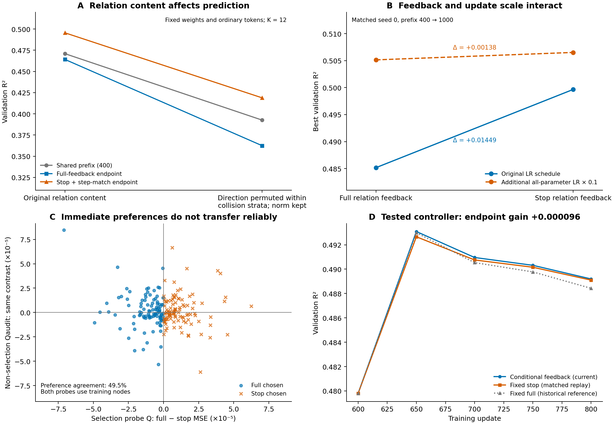

# GPM-More

**关系信息的前向使用与学习反馈：共享图编码器中的路径级控制。**

> 有用的关系信息，应该在多大程度上改变生成它的共享表示？

本项目基于 Graph Pattern Machine（GPM），保留局部 Pattern 编码流程，加入已有的跨 walk 相位关系 Token，并独立控制关系路径回传到共享编码器的梯度。前向始终使用完整关系信息，反馈强度由显式参数或预定调度控制。

研究故事见 **[STORY.md](docs/STORY.md)**，算子与梯度公式见 **[METHOD.md](docs/METHOD.md)**。

## 核心想法

普通 Pattern 和派生关系读取同一套表示，也通过同一个预测损失塑造它。我们将关系算子的输入写为

$$
\widetilde h_R=\operatorname{sg}(h)+\alpha\,[h-\operatorname{sg}(h)].
$$

前向值始终是 $h$，共享编码器的原始梯度变为 $g_P+\alpha g_R$。控制放在关系算子输入处，因此其下游可训练参数仍正常学习。AdamW 的实际位移还取决于历史矩，不能直接按该式缩放理解。

当前简单训练配置采用后期学习率控制与停止关系反馈。固定强度、完整反馈和停止反馈也可通过同一接口比较。动态探针开关在已有实验中收益不足，作为负结果记录在文档中。

## 已有发现



ArtNet-views，单种子，从同一第400步状态继续到1000；下表为最佳验证 R²：

| 后期学习率 | 完整关系反馈 | 停止关系反馈 |
|---|---:|---:|
| 原始调度 | 0.485170 | 0.499658 |
| 额外 ×0.1 | 0.505139 | 0.506518 |

固定权重的关系内容置换会损害预测；保持关系前向内容、改变反馈方式，则会改变训练后的验证表现。两类干预支持分别研究信息价值和反馈作用。学习率控制承担了较大部分收益，局部关系更新也可能净有益，因此现有证据不支持关系梯度普遍有害。

另一次600→800步的匹配实验中，逐步探针选择相对固定停止反馈仅增加 **0.000096 R²**，两批训练探针的候选偏好一致率为 **49.5%**。这个控制器没有进入保留方法。

这里发布的是机制研究及其归档结果。结果采用不同起点、干预与评估范围，详细说明见 [FINDINGS.md](docs/FINDINGS.md) 和 [EVIDENCE.md](docs/EVIDENCE.md)。它们不是 GPM/G²PM 标准主表上的新优势；新整理的代码也没有重新生成这些历史训练轨迹。

## 安装

Python 3.10+，PyTorch 2.4+。训练前根据设备安装合适的 PyTorch，再执行：

```bash
git clone https://github.com/HayesShi/GPM-More.git
cd GPM-More
python -m pip install -e ".[data,plots,dev]"
python -m pytest
```

核心模型只依赖 PyTorch 和 NumPy。`data` 提供采样与分类指标所需依赖，`plots` 用于重画图，`dev` 用于测试。

本地 CPU 的11项测试已通过；同一历史权重在四种 walk 预算下的活动前向与旧实现完全一致。范围与记录见 [VALIDATION.md](docs/VALIDATION.md)。

## 直接使用模型

```python
from gpm_more import ModelConfig, RelationalPatternModel

model = RelationalPatternModel(ModelConfig(input_dim=50, num_outputs=1))
# x: [N,F]; paths: [B,K,9]; relations: [B,K,93]
output = model(x, paths, relations, feedback_alpha=0.0)
prediction = output["prediction"]
```

`feedback_alpha=1` 为完整反馈，`0` 为停止关系反馈。推理时两者具有相同的前向计算。模型输出还包含共享上下文、普通 Token 和关系 Token，便于进行路径级干预分析。默认保留实际 raw_sum256 的均值读出、四尺度掩码与匿名路径 GRU。

## 在真实图上运行

可以直接输入自己的已预处理图 NPZ，格式见 [USAGE.md](docs/USAGE.md)。GraphLand 数据可使用其官方发布和固定版本预处理：

```bash
python -m pip install -e ".[graphland]"
python scripts/fetch_graphland.py --dataset artnet-views --root data/graphland --output data/artnet_graph.npz
gpm-more prepare --graph data/artnet_graph.npz --name artnet-views --task regression --output data/artnet --seed 0
gpm-more train --data data/artnet --config configs/artnet_feedback.json --output runs/artnet-feedback --device cuda:0
```

新采样和从头训练用于建立自己的实验；历史表中的结果依赖原有结构预训练权重、缓存和继承优化器状态。已有权重可用 `--init-weights` 导入，完整续训使用本训练器生成的 `--resume` checkpoint。数据下载、预处理与结果复现范围见 [DATA.md](docs/DATA.md)。

## 重画已有结果

```bash
python scripts/plot_findings.py
```

该命令只读取仓库内的聚合 CSV，生成 PNG、SVG 和 PDF，不训练模型或读取数据标签。

## 项目结构

```text
src/gpm_more/       模型、相位算子、输入反馈控制、采样、数据与训练
configs/           完整反馈和后期停止反馈的匹配配置
docs/              研究故事、方法、发现、数据与使用说明
results/           真实实验的精简聚合数值及来源
figures/           从结果文件生成的核心图与辅助图
scripts/           官方数据获取与便携绘图入口
tests/             前向/梯度语义、算子、数据边界与精确续训验证
third_party/       GPM 原始许可
```

## 来源与许可

骨干改编自 [GPM 官方实现](https://github.com/Zehong-Wang/GPM) 的固定版本，原论文为 [Beyond Message Passing: Neural Graph Pattern Machine, ICML 2025](https://arxiv.org/abs/2501.18739)。参见 [NOTICE.md](NOTICE.md)、[MIT 许可](LICENSE) 与 [已有工作定位](docs/PRIOR_ART.md)。GraphLand 数据与预训练权重不随仓库分发。
