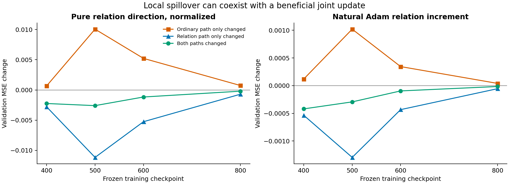
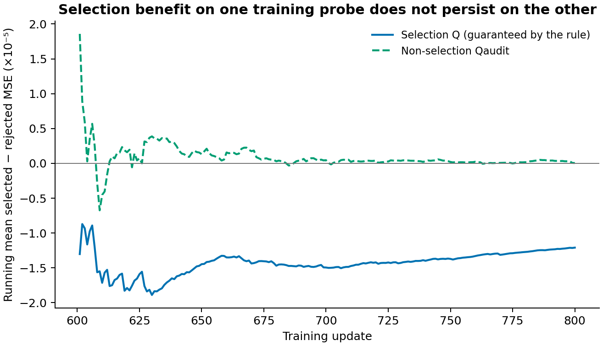

# 实验证据与图表来源

本目录记录已完成的 ArtNet-views 机制实验。所有结果均为已有 seed 0 的训练或固定权重干预；测试标签未参与实验。这里没有新的 GPM/G²PM 标准主表结果，也没有多种子误差条。

## 一张图串起已支持的发现


**A：关系内容影响预测。** 固定权重和普通 Pattern Token，只在碰撞水平分层内置换关系 Token 的方向，并保留接收节点的原始范数。原生终点 R² 从 0.464124 降至 0.362450；步幅匹配终点从 0.495522 降至 0.418851。该反事实支持节点对应内容被模型使用。置换仍改变关系与普通 Token 的联合分布，保范数也没有保持全部 LayerNorm 统计，因此不能把它扩展成完整的图语义因果识别。

**B：关系反馈与更新尺度相互作用。** 同一第400步起点继续训练到1000，原调度下停止反馈使最佳验证 R² 从 0.485170 提高到 0.499658。额外全参数学习率乘0.1后，完整反馈与停止反馈分别为0.505139和0.506518。停止反馈的附加收益缩小，说明它的作用依赖优化条件。这里学习率倍率也作用于预测头和 AdamW 权重衰减。

**C：即时选择信号未稳定转移。** 另一轮实验每步在Q中比较完整/停止两个真正的AdamW候选。Qaudit没有参与选择。两批各128个训练根节点，排除当前梯度批次，且彼此不重合；图邻域可能重叠。200步中二者偏好一致率49.5%，因此不能把Q上的选择优势当成跨样本收益。这是相关训练步骤上的描述，不是独立重复实验的显著性判断。

**D：动态选择未带来足够的连续训练收益。** 从实际第600步状态继续到800，条件反馈终点R²为0.489194989，匹配重跑的固定停止反馈为0.489099205，差值0.000095785。灰色虚线来自同配置历史完整反馈，不是本轮重新训练。该原型没有达到事先规定的0.001继续门槛，因此没有进入保留方法。

A/B来自第400步开始的原实验，C/D来自第600步开始的短程试验。起点、优化器历史与区间不同，不能将两组R²直接排列成统一排行榜。图中连接的是实际观测点，没有曲线平滑、外推或虚构误差区间。

## 结果文件

| 文件 | 内容与单位 | 适用范围 |
|---|---|---|
| [training_interventions.csv](../results/training_interventions.csv) | 五个匹配训练分支的最佳/终点验证R² | 同一原始update400前缀，继续600步至1000 |
| [forward_content_interventions.csv](../results/forward_content_interventions.csv) | 3个固定状态×8种内容替换；验证R²、标准化目标MSE | 固定权重反事实，不是8个新训练方法 |
| [local_path_exchange.csv](../results/local_path_exchange.csv) | 4个状态×2种方向×2个位移尺度×train/validation；四格预测交换 | 完整训练目标构造局部方向；仅移动14个共享张量 |
| [fixed_dose_endpoints.csv](../results/fixed_dose_endpoints.csv) | α∈{0,0.5,1}×LR∈{1,0.1}的六条短程训练结果 | 实际update600→800；共同完整梯度裁剪系数 |
| [fixed_dose_validation_curves.csv](../results/fixed_dose_validation_curves.csv) | 上述六条训练的预定验证点 | 不能把局部α曲线与训练轨迹混淆 |
| [stochastic_paired_steps.csv](../results/stochastic_paired_steps.csv) | 8次固定状态原生批次的配对MSE/R²差及路径交换 | 16个临时Adam候选，不是16个训练模型 |
| [stochastic_aggregates.csv](../results/stochastic_aggregates.csv) | 上述8次的描述性均值、范围和计数 | draw不是独立编码器种子 |
| [mse_interaction_decomposition.csv](../results/mse_interaction_decomposition.csv) | 四路径MSE交互的精确分解 | 99.60%比例仅指这8次配对的平均交互差异 |
| [conditional_endpoints.csv](../results/conditional_endpoints.csv) | 条件/固定停止的本轮结果及明确标注的历史参照 | 两条本轮训练各200步，同起点与随机流 |
| [conditional_validation_curves.csv](../results/conditional_validation_curves.csv) | 主比较的600/650/700/750/800验证R² | 601为工程观测，没有纳入最佳值选择 |
| [conditional_probe_steps.csv](../results/conditional_probe_steps.csv) | 每步两个候选在Q/Qaudit上的MSE、选择、位移范数 | 只含聚合量，没有节点ID、逐节点标签或权重 |
| [conditional_probe_mechanism.csv](../results/conditional_probe_mechanism.csv) | 同一风险差的残差对齐项与预测位移平方项 | 从原始预测以float64重算，恒等式残差约10⁻¹⁶ |
| [conditional_probe_summary.json](../results/conditional_probe_summary.json) | 99次full/101次stop、偏好转移、均值与预定门槛结果 | Qaudit仍为训练数据，不是外部验证集 |
| [conditional_compute.json](../results/conditional_compute.json) | 实际更新/反向/候选次数、计时和运行环境 | 分离算法Q前向与额外研究Qaudit前向；不是优化实现的加速比 |

这里的MSE对应使用训练标签拟合的目标标准化。除明确标为其他scope的行外，任务结果是验证集R²。CSV保留原始数值精度，文档只为阅读进行四舍五入。

## 局部干预对解释的约束



在4个已测状态、两个预设正向位移尺度，纯关系方向和自然Adam关系增量都可能损害普通路径、改善关系路径，但联合更新仍降低验证MSE。它支持共享路径的牵连效应，没有证明关系反馈总是净有害。状态800中，单独两路径变化的损益比较甚至会给出错误的净损害判断；联合项会改变结果。

纯关系方向经过冻结二阶矩预条件并按预设实际步长归一化；自然Adam增量由同状态的完整/停止候选位移相减得到。两者幅度口径不同，不能按图中纵轴绝对值评价哪种训练算法更好。400状态使用原前缀；500/600/800是后续重放状态及其自己的矩和随机流，未逐比特恢复历史缺失状态。

四格交换设a=p₁₀−p₀₀、b=p₀₁−p₀₀、c=p₁₁−p₁₀−p₀₁+p₀₀、e=p₀₀−y，平方损失交互满足：

$$
I=2\mathbb E[ab]+2\mathbb E[(e+a+b)c]+\mathbb E[c^2].
$$

即使预测变化可加（c=0），损失仍有交叉项。旧8次配对的平均验证损失交互差异中99.60%来自第一项，不能据此宣称长期训练退化主要由Transformer的非线性预测冲突造成。

## 选择规则的非选择核验



选择探针Q上被选候选的风险更低，是选择规则直接保证的性质。Qaudit上的平均“被选−未选”MSE为+5.23×10⁻⁸，接近零。图中的累计均值用于展示局部偏好是否转移，不是训练收益累积式，不能相加解释最终R²。

## 再生成图与复现范围

在仓库根目录执行：

```bash
python scripts/plot_findings.py
```

仅需NumPy和Matplotlib，脚本不加载模型、不训练、不使用GPU。它从仓库内结果CSV再生成`findings`、`local_paths`、`probe_transfer`的PNG/SVG/PDF；SVG保留矢量文本。图已实际渲染核验。

这些文件是历史实验的可移植聚合证据包，可以复核文档数字和重画图。历史训练还依赖当时的数据划分、walk缓存、SSL源权重和中途Adam/RNG状态；它们没有作为公开数据或模型资产随本仓库上传。新的独立实现与训练入口用于运行本方法，不能因接口相同就声称已经逐比特重现本表。来源分组和配置口径记录在[manifest.json](../results/manifest.json)。
